# 🌸 LilyAI — Classificação Inteligente de Espécies de Lírios


## 🎓 Informações acadêmicas

- **Estudante:** Vitória Passos
- **Disciplina:** Machine Learning
- **Atividade:** ML Challenge — Atividade Individual
- **Data:** 25/11/2026

## 🌿 Sobre o projeto

O LilyAI é uma aplicação de Machine Learning desenvolvida
para classificar espécies de lírios a partir de suas
características morfológicas.

O projeto utiliza dados científicos reais e algoritmos de
aprendizado supervisionado para identificar três espécies
do gênero Lilium.

A aplicação disponibiliza uma interface interativa,
permitindo que o usuário informe medidas físicas de uma
flor e obtenha uma previsão de sua espécie.

## 🎯 Objetivo

Desenvolver uma aplicação capaz de classificar espécies
de lírios utilizando algoritmos de Machine Learning,
comparando o desempenho de dois modelos de classificação.

O sistema pode ser utilizado como ferramenta educacional
de apoio ao estudo de botânica, biodiversidade e ciência
de dados.

## 🌺 Espécies classificadas

- Lilium henryi
- Lilium regale
- Lilium leucanthum

## 📚 Base de dados

Os dados foram obtidos do repositório científico Dryad,
a partir de uma pesquisa sobre características florais
e polinização de espécies de lírios.

- Autor: Chang-Qiu Liu
- Instituição: Guangxi Institute of Botany
- Ano de publicação: 2021
- Licença dos dados: CC0 1.0, conforme política do Dryad
- Data de acesso: 24/11/2026
- Fonte: https://doi.org/10.5061/dryad.5qfttdz6c

Foi utilizada a aba Morphology do arquivo
Floral_traits.xlsx.

Foram selecionadas 87 amostras de três espécies.

| Espécie | Amostras |
|---|---:|
| Lilium henryi | 30 |
| Lilium regale | 27 |
| Lilium leucanthum | 30 |
| Total | 87 |

## 📋 Variáveis utilizadas

| Variável | Descrição | Tipo |
|---|---|---|
| comprimento_tubo | Comprimento do tubo floral em mm | Numérica |
| curvatura_tepala | Razão adimensional de curvatura da tépala | Numérica |
| especie | Espécie do lírio | Categórica |

A coluna especie representa a variável-alvo que será
prevista pelos algoritmos.

## 📊 Análise exploratória

A análise exploratória foi realizada com Pandas,
Matplotlib e Seaborn.

Foram verificadas as dimensões da base, a distribuição
das classes, as estatísticas descritivas, os valores
ausentes e os registros duplicados.

### Distribuição das espécies

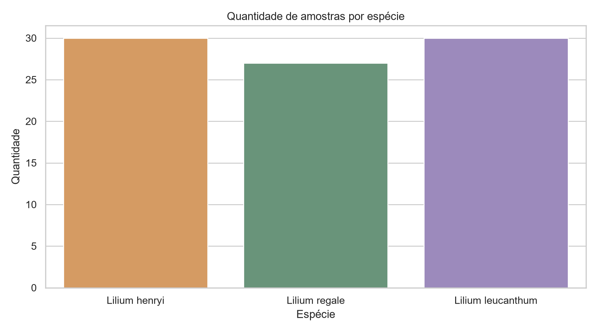

### Características morfológicas

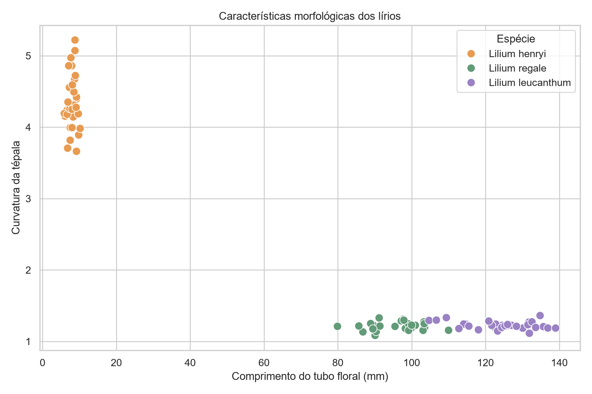

### Principais conclusões

1. As três espécies possuem quantidades semelhantes
   de amostras, apresentando uma distribuição
   aproximadamente equilibrada.

2. A espécie Lilium henryi apresenta comprimento médio
   do tubo floral de 8,08 mm e curvatura média de 4,3473,
   distinguindo-se das outras espécies.

3. As espécies Lilium regale e Lilium leucanthum possuem
   características morfológicas semelhantes, especialmente
   na curvatura da tépala, o que pode ocasionar erros
   de classificação.

Não foram encontrados valores ausentes ou registros
duplicados nas 87 amostras selecionadas.

## ⚙️ Pré-processamento

O pré-processamento consistiu nas seguintes etapas:

- Leitura da planilha científica original.
- Seleção das três espécies.
- Organização das variáveis em formato tabular.
- Conversão dos atributos para valores numéricos.
- Verificação de valores ausentes e duplicatas.
- Separação dos atributos e da variável-alvo.
- Divisão estratificada dos dados em treino e teste.

A divisão utilizou aproximadamente 80% dos dados para
treinamento e 20% para teste, com random_state igual a 42.

| Conjunto | Amostras |
|---|---:|
| Treinamento | 69 |
| Teste | 18 |
| Total | 87 |

Foi utilizado Pipeline para garantir que as transformações
fossem ajustadas somente nos dados de treinamento em
cada etapa da avaliação.

O SimpleImputer foi incluído preventivamente para tratar
eventuais valores ausentes utilizando a mediana.

O algoritmo KNN utilizou StandardScaler para colocar
as variáveis em escalas comparáveis.

O Random Forest não necessitou de padronização, por
ser baseado em árvores de decisão.

## 🤖 Algoritmos de Machine Learning

### K-Nearest Neighbors (KNN)

O KNN classifica novas amostras considerando as classes
dos vizinhos mais próximos no espaço de características.

Neste projeto, foram utilizados cinco vizinhos (k = 5).

### Random Forest

O Random Forest combina múltiplas árvores de decisão
para realizar classificações.

Neste projeto, foram utilizadas 100 árvores, com
random_state igual a 42.

## 📈 Resultados e avaliação

Os dois algoritmos foram avaliados utilizando o mesmo
conjunto de teste, composto por 18 amostras.

As métricas de precisão, recall e F1-score foram
calculadas utilizando a média macro.

| Métrica | KNN | Random Forest |
|---|---:|---:|
| Acurácia | 83,33% | 88,89% |
| Precisão macro | 83,81% | 91,67% |
| Recall macro | 83,33% | 88,89% |
| F1-score macro | 83,22% | 88,57% |
| F1 na validação cruzada | 98,52% | 98,52% |
| Acertos no teste | 15/18 | 16/18 |

### Modelo selecionado

O algoritmo selecionado foi o K-Nearest Neighbors.

O critério de seleção definido no código foi o maior
F1-score macro obtido na validação cruzada estratificada
com cinco divisões, realizada exclusivamente sobre
o conjunto de treinamento.

Os dois algoritmos apresentaram o mesmo resultado
de 98,52% na precisão exibida da validação cruzada.

O código selecionou o KNN, primeiro algoritmo da lista,
por meio da função max aplicada aos resultados completos.

Embora o Random Forest tenha apresentado melhor desempenho
no conjunto de teste, foi mantido o critério original
de seleção para evitar escolher o modelo com base
repetidamente nos resultados de teste.

O KNN também apresenta simplicidade de implementação
e interpretação.

O modelo escolhido obteve 83,33% de acurácia no teste
e foi armazenado em models/model.joblib.

## 🔍 Matrizes de confusão

### KNN

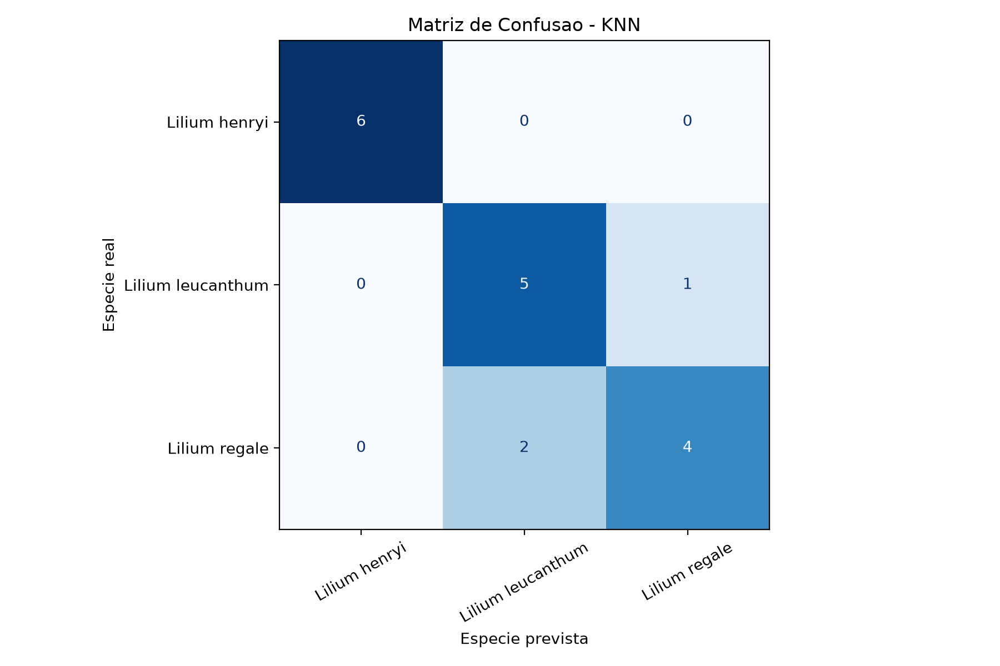

### Random Forest

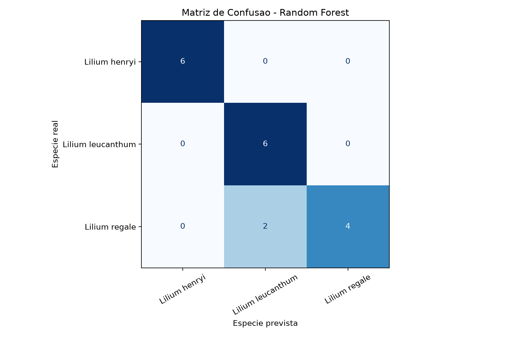

Ambos os modelos classificaram corretamente todas as
seis amostras de Lilium henryi presentes no teste.

Os principais erros ocorreram entre Lilium regale
e Lilium leucanthum, devido à sobreposição de suas
características morfológicas observadas.

## 💻 Interface da aplicação

A interface foi desenvolvida utilizando Streamlit e
possui três áreas principais:

- Identificar lírio.
- Análise dos dados.
- Desempenho dos modelos.

O usuário pode informar o comprimento do tubo floral
e a curvatura da tépala para obter uma classificação
realizada pelo modelo previamente treinado.

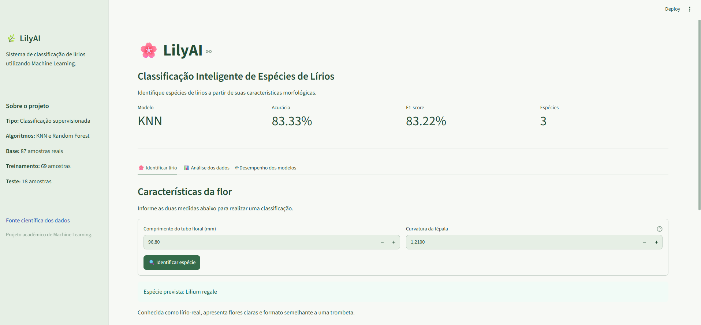

## 🧪 Testes funcionais

Foram realizados três testes de previsão e um teste
de validação de entrada.

| Teste | Comprimento (mm) | Curvatura | Resultado |
|---|---:|---:|---|
| 1 | 8,00 | 4,3500 | Lilium henryi |
| 2 | 96,80 | 1,2100 | Lilium regale |
| 3 | 126,00 | 1,2300 | Lilium leucanthum |
| 4 | 0,00 | 1,2300 | Entrada inválida bloqueada |

Os testes confirmaram o funcionamento da aplicação
com entradas distintas.

Esses casos são demonstrações funcionais e não
substituem as métricas do conjunto de teste.

### Teste 1 — Lilium henryi

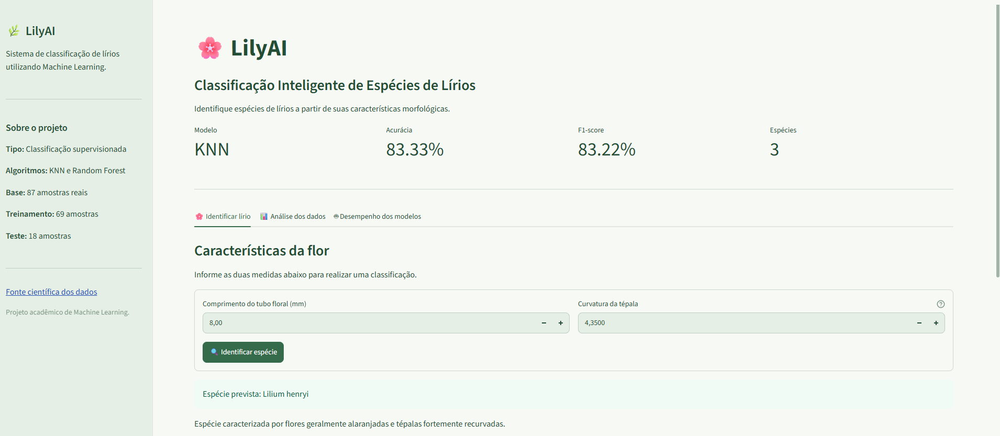

### Teste 2 — Lilium regale


### Teste 3 — Lilium leucanthum

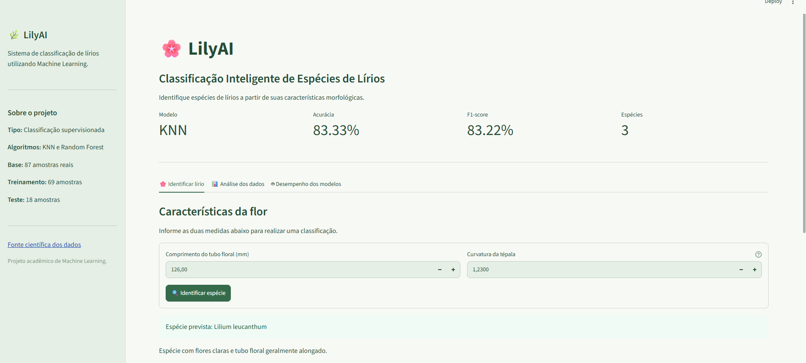

### Validação de entrada

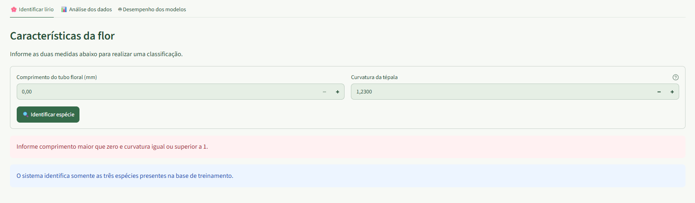

### Análise dos dados na aplicação

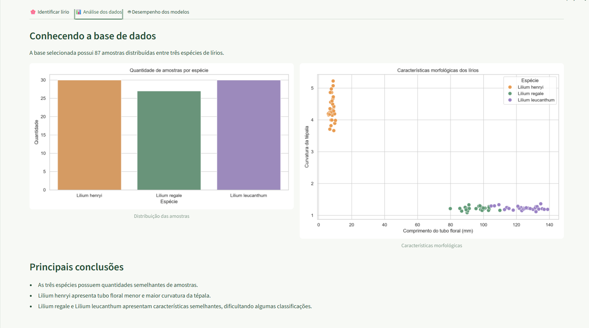

### Desempenho dos modelos na aplicação

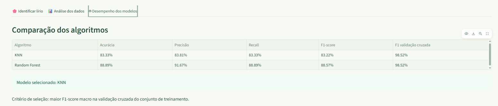

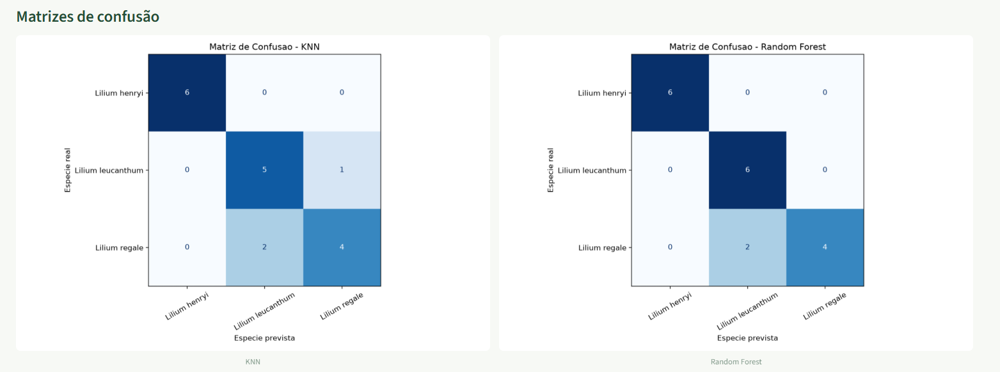

## 🛠️ Tecnologias utilizadas

- Python
- Pandas
- NumPy
- Scikit-learn
- Matplotlib
- Seaborn
- Streamlit
- Joblib
- Openpyxl
- Visual Studio Code
- Git e GitHub

## 📁 Estrutura do projeto

```text
LilyAI/
├── .streamlit/
│   └── config.toml
├── data/
│   ├── Floral_traits.xlsx
│   ├── readme.xlsx
│   ├── lilios.csv
│   └── README.md
├── models/
│   └── model.joblib
├── reports/
│   ├── metricas.json
│   └── graficos/
│       ├── quantidade_especies.png
│       ├── dispersao_especies.png
│       ├── matriz_knn.png
│       └── matriz_random_forest.png
├── screenshots/
├── analise.py
├── train.py
├── app.py
├── requirements.txt
├── .gitignore
└── README.md
```

## 🚀 Como executar o projeto

### 1. Pré-requisitos

- Python 3.15.2, versão utilizada no desenvolvimento.
- Git, caso deseje clonar o repositório.

Baixe ou clone o repositório e abra a pasta LilyAI
no terminal.

### 2. Criar um ambiente virtual

```bash
python -m venv .venv
```

### 3. Ativar o ambiente virtual

Windows PowerShell:

```powershell
.\.venv\Scripts\Activate.ps1
```

Linux ou macOS:

```bash
source .venv/bin/activate
```

### 4. Instalar as dependências

```bash
python -m pip install -r requirements.txt
```

### 5. Realizar a análise exploratória

```bash
python analise.py
```

### 6. Treinar os modelos

```bash
python train.py
```

### 7. Executar a aplicação

```bash
python -m streamlit run app.py
```

A aplicação estará disponível localmente em:

http://localhost:8501

## ⚠️ Limitações

- A base de dados possui somente 87 amostras.
- O conjunto de teste contém apenas 18 registros.
- O sistema classifica somente três espécies.
- São utilizadas apenas duas características físicas.
- O modelo pode confundir espécies morfologicamente
  semelhantes.
- Não foi realizada validação com populações externas.
- O sistema não reconhece fotografias.
- As pontuações do modelo não representam certeza
  científica da identificação.

O LilyAI é um protótipo educacional e não substitui
a identificação realizada por especialistas em botânica.

## 🔮 Melhorias futuras

Para uma futura versão do LilyAI, pretende-se:

- Ampliar a quantidade de amostras.
- Incluir novas espécies de lírios.
- Adicionar novas características morfológicas.
- Avaliar o modelo com bases de dados independentes.
- Implementar reconhecimento de espécies por fotografias
  utilizando técnicas de visão computacional.
- Disponibilizar a aplicação online.

## 🧠 Declaração de uso de Inteligência Artificial

O ChatGPT foi utilizado como ferramenta de apoio
ao desenvolvimento deste projeto, auxiliando na
orientação técnica, elaboração dos códigos,
interpretação das métricas e documentação.

Os códigos foram executados e testados pelo estudante.
Os gráficos, métricas e previsões apresentados foram
obtidos por meio da execução dos algoritmos sobre
os dados científicos selecionados.

## 📖 Referências

LIU, Chang-Qiu. Data from: Papilio butterfly vs.
hawkmoth pollination explains floral syndrome dichotomy
in a clade of Lilium. Dryad, 2021.

DOI: https://doi.org/10.5061/dryad.5qfttdz6c

Artigo científico associado:
https://doi.org/10.1093/botlinnean/boab074

Documentação Scikit-learn:
https://scikit-learn.org/

Documentação Streamlit:
https://docs.streamlit.io/

Documentação Pandas:
https://pandas.pydata.org/docs/

Política de publicação do Dryad:
https://datadryad.org/publication_policy

---

🌿 LilyAI 1.0 — Projeto acadêmico de Machine Learning.
